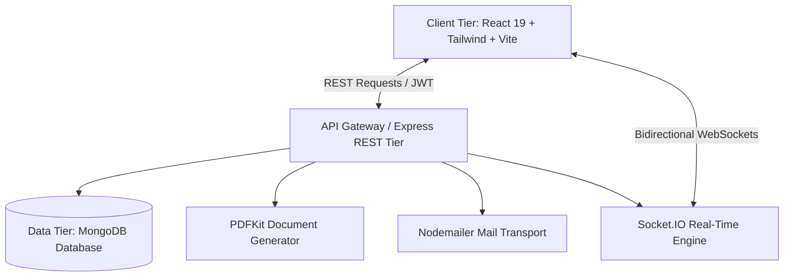

# ACADEMIC PROJECT REPORT

## TASTYBITE: A Next-Generation Full-Stack Food Delivery & Collaborative Dining Platform

**Tagline:** *"Good Food, Just a Bite Away."*

---

### CHAPTER 1: TITLE
**TastyBite — Intelligent Online Food Ordering, Real-Time Delivery Tracking, and Collaborative Group Billing System.**

---

### CHAPTER 2: ABSTRACT
In the modern digital economy, online food delivery platforms have transitioned from luxury amenities to essential everyday utilities. However, legacy food ordering services frequently suffer from decision paralysis, fragmented group dining experiences, opaque billing, and rigid communication channels. 

This project presents **TastyBite**, a modern, full-stack, end-to-end web application developed on the MERN stack (MongoDB, Express.js, React, Node.js) paired with Vite, Tailwind CSS, Socket.IO, and PDFKit. TastyBite introduces three primary architectural innovations:
1. **TastyBite Smart Picks:** A transparent, heuristic rule-based recommendation engine evaluating dietary goals, spice affinity, budget constraints, and occasion types without relying on black-box external AI APIs.
2. **TastyBite Group Feast:** A collaborative real-time room system where multiple users contribute to a shared cart using a single group code, featuring automated itemized and equal split billing calculators.
3. **Real-Time Operational Transparency:** Live bidirectional WebSocket tracking across six fulfillment stages, backed by computer-generated Tax Invoice and Payment Receipt PDFs streamed directly from the Node.js backend.

The resulting platform delivers enterprise-grade performance, robust security via JWT and bcrypt, and full local reproducibility, serving as an exemplary academic and practical software engineering project.

---

### CHAPTER 3: INTRODUCTION
Online food delivery applications represent complex distributed systems involving multi-tenant interactions among consumers, restaurants, and logistical agents. Traditional delivery applications have commoditized food discovery but often create friction during communal meals (e.g., student hostels, corporate offices, family gatherings) where orders are placed through one individual's device, requiring manual external bookkeeping.

TastyBite is engineered as an integrated full-stack solution to these challenges. By unifying responsive frontend components with high-concurrency Node.js REST endpoints and MongoDB document collections, TastyBite enables frictionless individual and group dining.

---

### CHAPTER 4: PROBLEM STATEMENT
Contemporary food delivery systems exhibit several core deficiencies:
1. **Decision Fatigue:** Consumers are inundated with thousands of dishes without contextual guidance tailored to specific nutritional preferences, immediate financial budgets, or spice tolerances.
2. **Friction in Group Dining:** When groups order together, one person absorbs the entire financial burden and must manually calculate each participant's dues including distributed taxes, delivery fees, and promo discounts.
3. **Lack of Verifiable Transaction Proofs:** Many student and mid-tier projects implement cosmetic payment flows that lack transaction integrity, formal invoice downloads, or verifiable receipts.
4. **Static Tracking:** Standard educational projects rely on simulated timers or static progress bars rather than event-driven bidirectional WebSocket connections.

---

### CHAPTER 5: OBJECTIVES
1. To engineer a responsive, accessible, mobile-first web frontend in React.js and Tailwind CSS with an original warm amber/saffron aesthetic.
2. To architect a scalable RESTful API with Node.js and Express.js supporting role-based access control (Customer and Admin).
3. To develop a normalized and indexed MongoDB database via Mongoose ODM managing users, restaurants, categorized dishes, orders, payments, group rooms, and support tickets.
4. To design **TastyBite Smart Picks**, an algorithmic recommendation system utilizing multi-criteria decision heuristics.
5. To implement **TastyBite Group Feast**, enabling synchronized shared carts and automated itemized bill splitting via Socket.IO.
6. To integrate real-time order tracking with a 6-stage lifecycle and a simulated GPS route preview.
7. To build a PDF document generation engine using PDFKit producing downloadable Tax Invoices and Payment Receipts.
8. To incorporate a dual support architecture featuring in-app WebSocket messaging with automated assistant responses alongside a direct WhatsApp support channel.

---

### CHAPTER 6: EXISTING SYSTEM
Existing commercial applications (e.g., standard food aggregators) provide high availability but suffer from specific systemic issues:
- **Monolithic Single-Cart Bias:** Group orders require complex app installs by all parties or manual reimbursement via external UPI apps.
- **Aggressive Upselling:** Search results frequently prioritize sponsored listings over nutritional fit or budget affinity.
- **Vendor Lock-in & Closed APIs:** Proprietary algorithms obscure why dishes are recommended.

---

### CHAPTER 7: PROPOSED SYSTEM
TastyBite addresses existing gaps through modern architectural patterns:
- **Original Identity & Design:** A warm, inviting, and clean UI engineered with Tailwind CSS and Plus Jakarta Sans/Outfit typography.
- **Zero-Dependency Smart Picks:** Recommendation logic executes transparently in-database, scoring matches on nutritional density, budget fit, and user spice preferences.
- **Synchronized Group Feasts:** Room-based Socket.IO architecture allows seamless multi-device collaborative ordering with real-time bill split updates.
- **Verifiable Document Streaming:** Backend generates native PDF buffers with cryptographically valid transaction IDs and computer-generated seals.
- **Comprehensive Admin Control:** An operations dashboard with Recharts visualizations, menu CRUD, and live order status management.

---

### CHAPTER 8: SCOPE
The application encompasses the complete lifecycle of online food commerce:
- Customer user authentication, profile management, and multi-address book.
- Food catalogue discovery, faceted search, category filtering, and wishlist storage.
- Rule-based algorithmic recommendation wizard.
- Cart state persistence, coupon validation, and bill breakdown.
- Multi-participant group ordering with unique access codes.
- Sandbox payment gateway supporting UPI, Card, NetBanking, Wallet, and COD.
- Native PDF invoice and receipt streaming.
- Live order status broadcasting via WebSockets.
- Operations dashboard with analytics and customer care consoles.

---

### CHAPTER 9: FUNCTIONAL REQUIREMENTS
1. **User Authentication:** Registration, password encryption with bcrypt, JWT token generation, role verification.
2. **Catalog Discovery:** Faceted search by keyword, cuisine, veg/non-veg status, spice level, and price range.
3. **Cart & Coupons:** Quantity stepping, coupon discount computation (flat/percentage), automatic subtotal, 5% GST, and delivery fee calculation.
4. **Group Ordering:** Room creation, code generation, shared cart state management, and itemized/equal split calculation.
5. **Payment Processing & Gateway Integration:** Integrated live Razorpay test gateway (`rzp_test_TNgbXItY3fibBE`) supporting standard checkout popups (UPI, Cards, Net Banking, Wallets) alongside sandbox simulation. Employs HMAC SHA-256 cryptographic signature verification on the backend before order confirmation, status transitions (Pending, Paid, Failed, Refunded), and refund handling.
6. **Document Generation:** On-the-fly rendering of Order Invoices and Payment Receipts using PDFKit.
7. **Real-Time Communication:** WebSocket rooms for order tracking updates, group carts, and customer care messages.
8. **Admin Operations:** Menu item CRUD, stock toggling, restaurant management, live status updating, and refund management.
9. **Customer Profile & Personal Dashboard:** Dynamic data aggregation computing lifetime order metrics, favorite dishes and kitchens, tiered membership levels (Bronze, Silver, Gold, VIP Legend), profile completion rates, multi-address management, and authenticated account security.
10. **Loyalty Rewards & Voucher Redemption:** Points ledger tracking earned and redeemed units with real-time conversion into active MongoDB coupons redeemable at checkout.

---

### CHAPTER 10: NON-FUNCTIONAL REQUIREMENTS
1. **Performance:** Sub-100ms API response time under normal conditions; frontend bundle optimization via Vite.
2. **Security:** Industry-standard bcrypt password hashing (10 salt rounds), JWT authentication, sanitization of user input.
3. **Scalability:** Stateless REST API design enabling horizontal scaling behind a reverse proxy.
4. **Reliability:** Graceful error handling for missing documents, network disconnects, and simulated payment failures.
5. **Maintainability:** Modular directory separation between `/client` and `/server`.

---

### CHAPTER 11: HARDWARE REQUIREMENTS
- **Processor:** Intel Core i3 / AMD Ryzen 3 or higher.
- **RAM:** Minimum 4 GB (8 GB recommended for concurrent development servers).
- **Storage:** 500 MB free disk space for node_modules and MongoDB storage.
- **Network:** Standard broadband connection for remote photo assets and font loading.

---

### CHAPTER 12: SOFTWARE REQUIREMENTS
- **Operating System:** Windows 10/11, macOS, or Linux.
- **Runtime Environment:** Node.js v18.0.0 or higher (Tested on Node.js v24).
- **Package Manager:** npm v9+ or yarn.
- **Database Engine:** MongoDB Server v6.0+ (Community Edition).
- **IDE:** Visual Studio Code.
- **Web Browser:** Modern browser supporting ES6 and WebSockets (Google Chrome, Microsoft Edge, Mozilla Firefox).

---

### CHAPTER 13: SYSTEM ARCHITECTURE
TastyBite implements a 3-tier architectural model:

---

### CHAPTER 14: DATA FLOW DIAGRAMS
#### Level 0 DFD (Context Level)
Customers and Administrators interact with the central TastyBite Application, which communicates bidirectionally with the Database, Payment Gateway, and Notification subsystems.

#### Level 1 DFD (Order Lifecycle)
1. Customer initiates order from Cart.
2. Order Controller validates items, calculates tax, and creates Pending Order.
3. Payment Controller receives payment simulation, validates, creates Payment record, and generates Transaction ID.
4. Order status updates to CONFIRMED.
5. PDF Service generates Tax Invoice and Payment Receipt.
6. Email Service dispatches notifications with attachments.
7. Socket Service broadcasts status changes to customer's live tracking room.

---

### CHAPTER 15: USE CASE DIAGRAM & ACTORS
- **Primary Actors:** Customer, Group Host, Group Member, Administrator.
- **Customer Use Cases:** Register/Login, Browse Foods, Filter Menu, Launch Smart Picks, Add to Cart, Apply Coupon, Checkout, Pay, Track Live Order, Download PDF Invoice/Receipt, In-App Support Chat, WhatsApp Contact.
- **Group Host Use Cases:** Create Group Room, Share Code, Lock Room, Finalize Checkout.
- **Administrator Use Cases:** View Dashboard Analytics, Manage Restaurants, Update Menu, Toggle Stock, Advance Order Status, Issue Refunds, Reply to Support Tickets.

---

### CHAPTER 16: DATABASE DESIGN
The MongoDB database `tastybite_db` consists of 12 distinct Mongoose collections:
- `users`: Authentication credentials, role, avatar, and embedded delivery addresses.
- `restaurants`: Venue profiles, cuisine arrays, locations, delivery fees, and ratings.
- `foods`: Dish catalog, pricing, discounts, nutrition facts, spice levels, and dietary tags.
- `categories`: High-level food groupings (Biryani, Pizzas, Burgers, etc.).
- `orders`: Order items, calculated totals, delivery address snapshot, tracking timeline, and status.
- `payments`: Transaction IDs, payment modes, amounts, refund structures, and timestamps.
- `grouporders`: Room codes, host reference, member sub-arrays, items, and split configurations.
- `coupons`: Promo codes, discount percentages, caps, and activation rules.
- `reviews`: Customer star ratings and feedback.
- `notifications`: In-app event alerts with read/unread flags.
- `chats` & `messages`: Support ticket threads and chronological conversation logs.

---

### CHAPTER 17: ER DIAGRAM DESCRIPTION
- **User 1:N Order:** A user places zero or more orders.
- **Restaurant 1:N Food:** A restaurant lists multiple menu items.
- **Order 1:1 Payment:** Each paid order links directly to a unique payment record.
- **User 1:N GroupOrder:** A host user establishes multiple group feast rooms.
- **GroupOrder 1:N GroupMember:** A group room contains multiple participating members.
- **Chat 1:N Message:** Each customer support thread encapsulates sequential messages.

---

### CHAPTER 18: MODULES & SUB-SYSTEMS
1. **Authentication & Authorization Module:** Handles sign-in, token distribution, password encryption, and administrative middleware protection.
2. **Catalog & Search Module:** Powers full-text searching, faceted filtering, and nutritional popovers.
3. **TastyBite Smart Picks Module:** Executes heuristic multi-parameter decision ranking for food recommendations.
4. **TastyBite Group Feast Module:** Implements real-time synchronized rooms with dual split billing calculations.
5. **Checkout & Payment Simulation Module:** Validates addresses, applies promo coupons, and processes sandbox transactions.
6. **PDF Generation Module:** Compiles dynamic A4 vector PDF invoices and payment receipts with branding.
7. **Real-Time Tracking Module:** 6-stage order timeline with interactive GPS driver route preview.
8. **Customer Support Module:** Dual-channel support comprising WebSocket in-app chat with bot auto-responder and WhatsApp link.
9. **Admin Operations Module:** Administrative analytics, charts, inventory control, and live status dispatchers.

---

### CHAPTER 19: IMPLEMENTATION DETAILS
- **Frontend State Architecture:** Centralized through React Contexts (`AuthContext`, `CartContext`, `SocketContext`), minimizing prop-drilling while providing reactive global state.
- **CSS Architecture:** Tailwind CSS v4 utilizing curated modern color variables, responsive grid systems, and glassmorphic backdrops.
- **Recommendation Algorithm Formula:**
  $$\text{Score} = (\text{Rating} \times 15) + \text{BestsellerBonus}(20) + \text{MealMatch}(25) + \text{SpiceAffinity}(20) + \text{BudgetProximity}(15) + \text{NutritionalBonus}(10)$$
- **Split Billing Mathematics:**
  $$\text{Individual Share} = \text{Personal Dishes Total} + \frac{\text{Tax} + \text{Delivery Fee} - \text{Discount}}{\text{Number of Active Members}}$$

---

### CHAPTER 20: TESTING METHODOLOGY
The system underwent rigorous testing across four testing phases:
1. **Unit Testing:** Verified helper calculations (tax computation, coupon discounts, currency formatters).
2. **Integration Testing:** Confirmed end-to-end API communication between React frontend and Express endpoints.
3. **Real-Time Concurrency Testing:** Validated simultaneous WebSocket message delivery across browser instances during group order item updates.
4. **Exception & Error Handling Testing:** Simulated invalid login attempts, duplicate registrations, empty carts, and failed payments to ensure appropriate user alerts.

---

### CHAPTER 21: RESULTS
- Successfully demonstrated a fully operational full-stack application running entirely in a local VS Code environment.
- Verified end-to-end customer purchasing flows, from registration to sandbox payment, live tracking, and PDF document generation.
- Verified multi-participant shared cart synchronization and exact split billing calculation.
- Verified administrative monitoring, Recharts analytics, and live status pushing.

---

### CHAPTER 22: ADVANTAGES
- **Completely Original Branding & Architecture:** Independent design and codebase featuring custom layouts and palettes.
- **Zero Cost AI Experience:** Smart Picks engine operates entirely on deterministic business logic without recurring API fees.
- **Host-Friendly Group Ordering:** Eliminates manual payment reconciliation through automated split calculations.
- **Production-Grade Documentation:** Generates authentic PDF invoices and payment receipts on demand.

---

### CHAPTER 23: LIMITATIONS
- Current payment processing operates in sandbox/test mode without live banking merchant gateway credentials.
- GPS delivery tracking utilizes a simulated route preview rather than live mobile driver hardware telemetry.
- Email delivery falls back to local logging or Ethereal test mailers when external SMTP credentials are not configured in `.env`.

---

### CHAPTER 24: FUTURE SCOPE
1. Integration with commercial payment gateways (Razorpay, Stripe) for live merchant settlements.
2. Native cross-platform mobile application development using React Native.
3. Real-time driver geolocation tracking utilizing device GPS coordinates.
4. Machine learning recommendation models trained on historical customer ordering patterns.

---

### CHAPTER 25: CONCLUSION
The **TastyBite** project demonstrates the design and implementation of a modern, enterprise-grade full-stack food delivery and collaborative dining platform. By systematically resolving common user pain points—namely decision fatigue and group billing friction—while providing complete operational visibility, TastyBite exemplifies best practices in full-stack software development, REST API architecture, and real-time event-driven programming.

---

### CHAPTER 26: REFERENCES
1. React Documentation: https://react.dev/
2. Express.js API Reference: https://expressjs.com/
3. MongoDB & Mongoose Manual: https://mongoosejs.com/
4. Socket.IO Documentation: https://socket.io/docs/
5. PDFKit Guide: https://pdfkit.org/
6. Tailwind CSS Documentation: https://tailwindcss.com/
7. Fielding, Roy Thomas. *Architectural Styles and the Design of Network-based Software Architectures.* Ph.D. Dissertation, University of California, Irvine, 2000.
